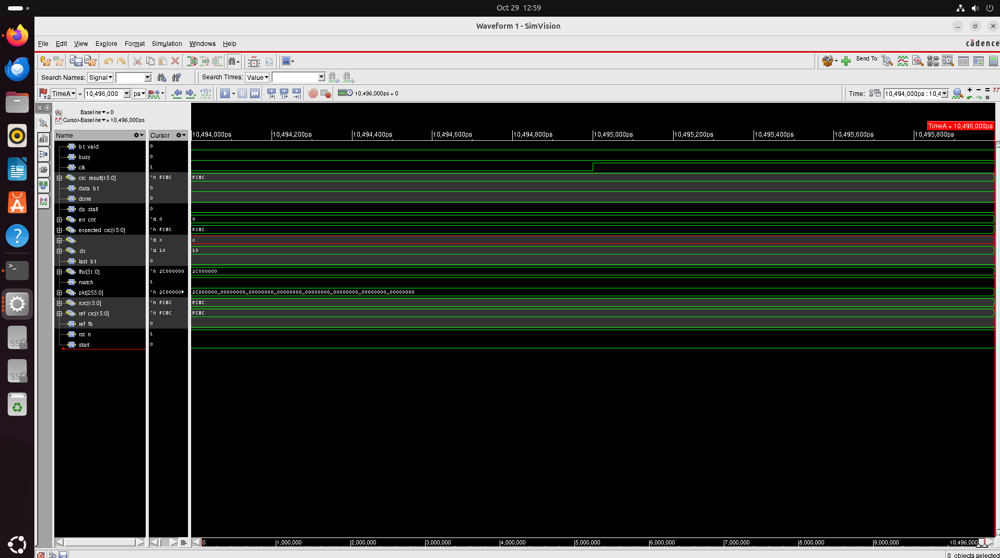
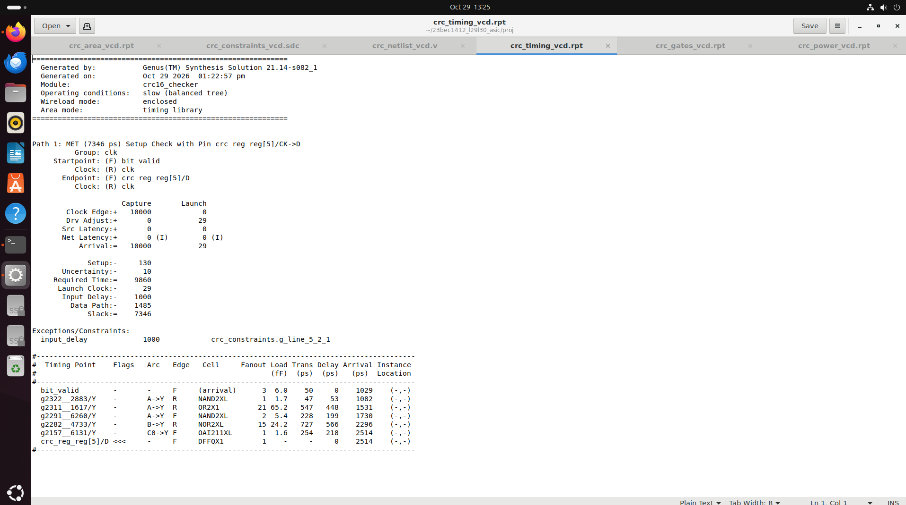
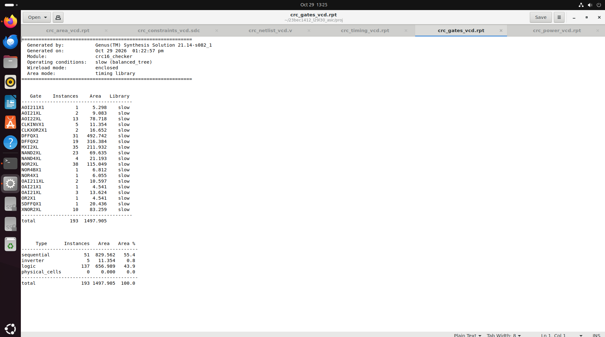
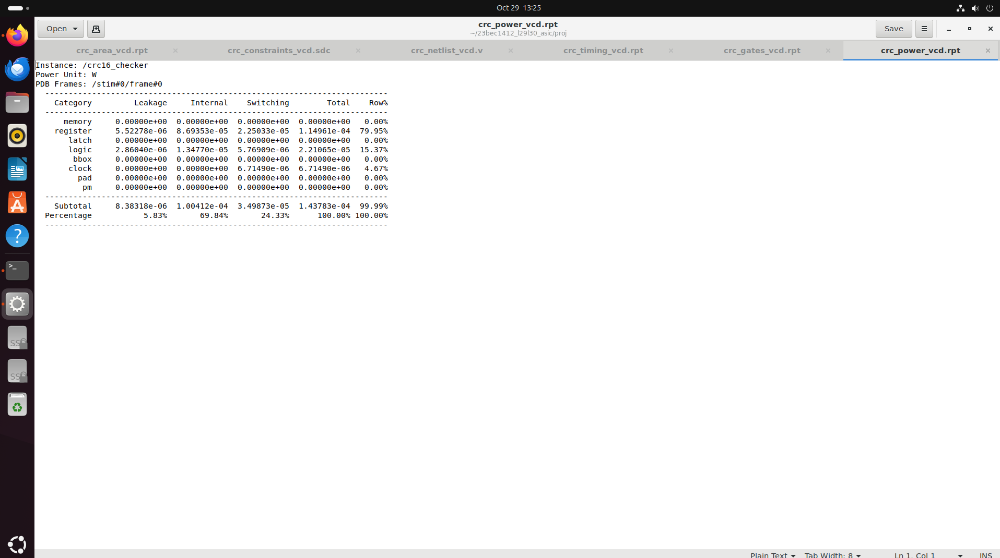
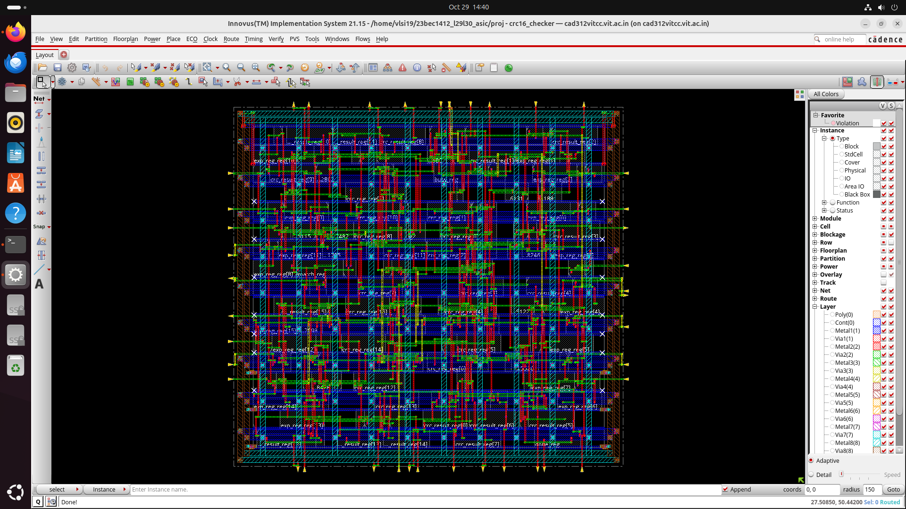
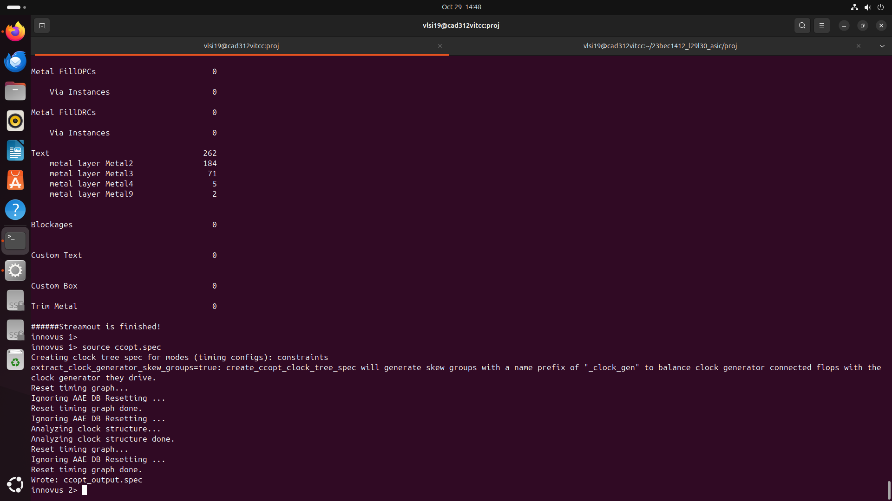
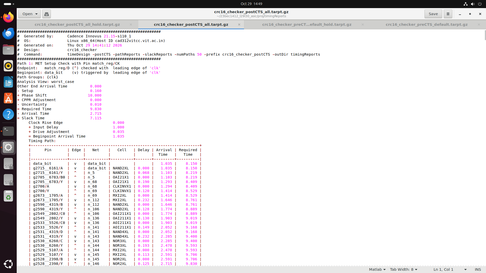
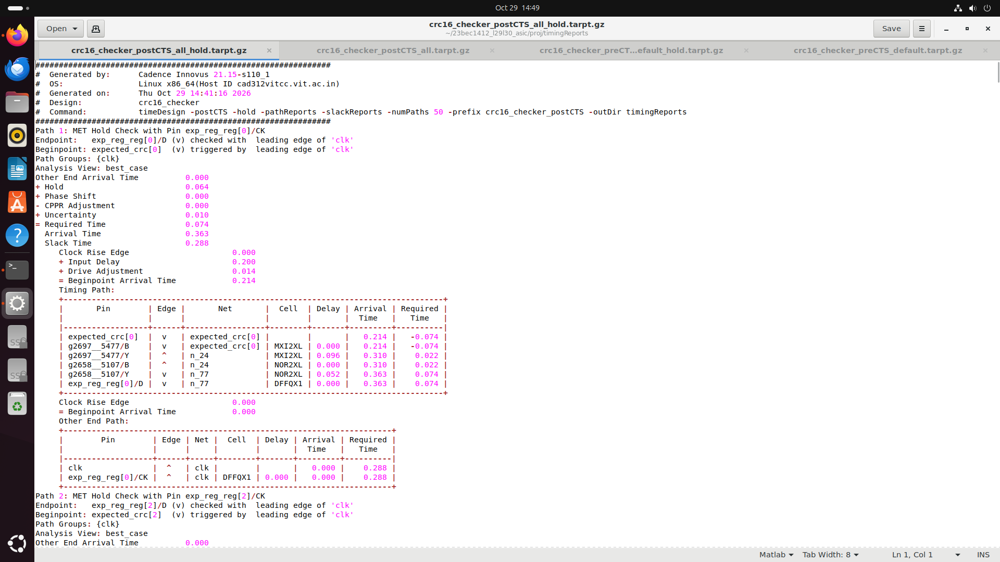
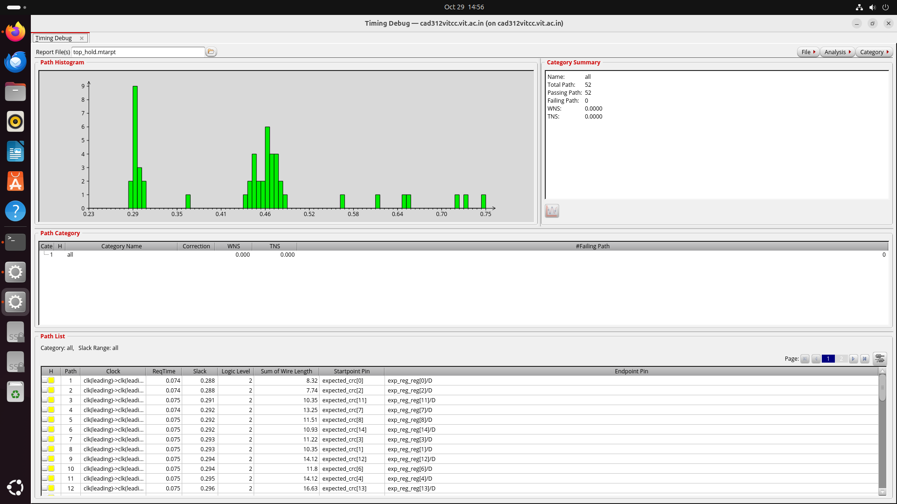
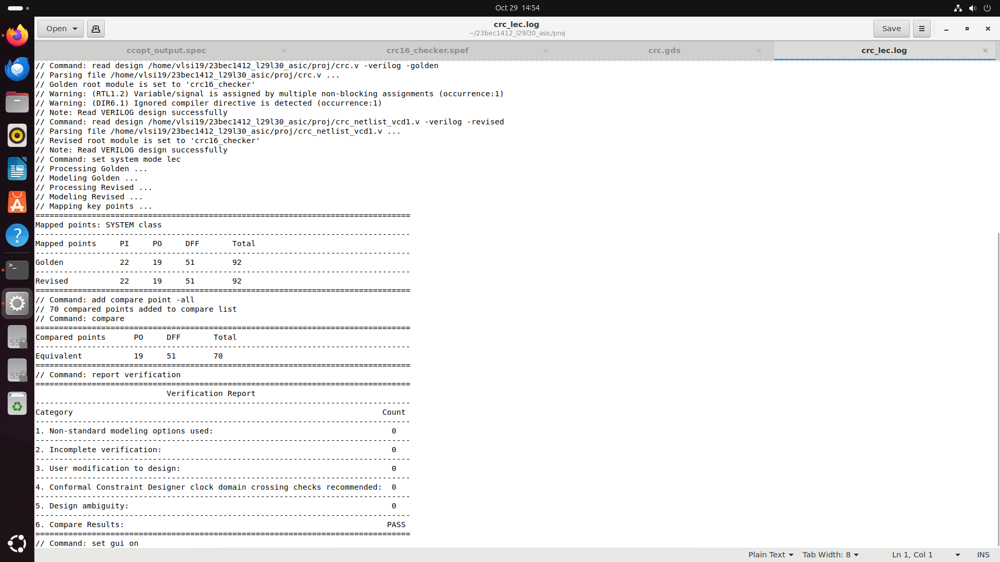

# CRC16 ASIC Flow: RTL-to-GDSII Physical Design

RTL-to-GDSII physical design flow for a CRC-16/CCITT checker (`crc16_checker`), implemented with Cadence tools. The design uses polynomial 0x1021, init 0xFFFF, MSB-first, with no reflection and no final XOR.

## Tools and Technology
- **Simulation:** Cadence SimVision (waveform debug) with a self-checking Verilog testbench
- **Synthesis:** Cadence Genus 21.14
- **Place, route, CTS, and timing:** Cadence Innovus 21.15
- **Equivalence checking:** Cadence Conformal LEC
- **Target clock:** 100 MHz (10 ns period)
- **Technology / library:** 90 nm

## Flow
1. RTL design and self-checking simulation (`rtl/`, `tb/`)
2. Logic synthesis with timing and area constraints (Genus, `constraints/`)
3. Netlist equivalence check against RTL (Conformal LEC)
4. Floorplan, placement, and clock tree synthesis (Innovus)
5. Routing and post-route timing analysis (Innovus)
6. Streamout to GDSII

## Results

| Metric | Result |
|---|---|
| Clock period (target) | 10.0 ns (100 MHz) |
| Setup slack, post-CTS | +7.115 ns (required 9.830 ns, arrival 2.715 ns) |
| Hold slack, post-CTS | +0.288 ns (worst path, no violations) |
| Standard cell count (synthesis) | 193 cells, 51 sequential |
| Cell area (synthesis) | 1497.9 µm² |
| Total power (simulation activity) | 114.1 µW |
| Equivalence check | 70 of 70 compare points equivalent (PASS) |

The setup and hold slack come from the post-CTS Innovus reports. The area and cell count come from the Genus synthesis report, so the post-route area may differ. Power comes from the report that uses simulation activity (VCD). A vectorless estimate from the same synthesized netlist gives 143.8 µW.

## Screenshots

### Simulation

### Synthesis (Genus)

### Place and Route (Innovus)

### Timing Closure

### Equivalence Check (Conformal LEC)

## Repository Structure
- `rtl/` RTL source (`crc.v`, module `crc16_checker`)
- `tb/` self-checking testbench (`crc_tb.v`): reset, known answers, 1 to 40 bit packets, random stalls, wrong-CRC detection, idle noise, back-to-back packets, reset during a packet
- `constraints/` SDC constraints (`crc16_checker.sdc`)
- `netlist/` Genus synthesized netlist and Innovus post-route netlist
- `reports/` area, gate count, power, and timing reports
- `scripts/` Genus, Innovus, and LEC Tcl scripts
- `docs/screenshots/` key screenshots from the flow

## Author
Gopikasree R
